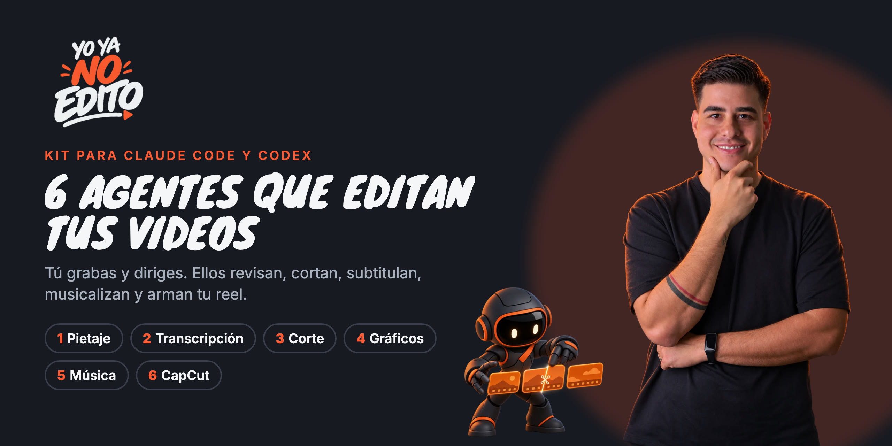

# Yo Ya No Edito · Kit de 6 agentes para editar tus videos con IA

Este es el equipo con el que [@soyluchorivero](https://www.instagram.com/soyluchorivero/) edita sus reels, simplificado para que lo uses desde cero. Tú grabas y diriges; seis agentes de IA hacen la edición:

**Pietaje → Transcripción → Corte → Gráficos → Música → CapCut**

## Empieza aquí

No descargues nada a mano. Tu agente baja el kit y prepara tu computadora.

1. Instala **Claude Code** (o **Codex**) y crea una carpeta vacía, por ejemplo «Mis videos».
2. Abre esa carpeta en Claude Code (o en Codex) y pega este mensaje:

   > Instala el kit de https://github.com/luishernandezr123/yanoeditokit en esta carpeta, entra a la carpeta y prepara mi equipo de edición con su skill preparar-equipo. Pídeme permiso antes de instalar.

3. Tu agente revisa tu computadora y te dice qué falta: «toca instalar esto, esto y esto». Separa lo obligatorio de lo opcional y te pregunta **una sola vez** si lo instala. Nada se instala sin tu «sí».
4. Lo que pide tu contraseña o abre un instalador con ventanas (Homebrew, Node, CapCut) lo haces tú; el agente te explica cada paso.
5. Al final hace una prueba corta (crea un audio, lo transcribe y saca una foto de la plantilla) y, si todo funciona, deja el archivo `.equipo-listo`.
6. Cierra y vuelve a abrir Claude Code o Codex **dentro de la carpeta `yanoeditokit`**: así carga a luchoeditor, a los 6 agentes y sus skills.

Cómo copia el kit tu agente (por si quieres hacerlo tú):
```
git clone https://github.com/luishernandezr123/yanoeditokit.git
```
Si no tienes git:
```
curl -L -o yanoeditokit.zip https://github.com/luishernandezr123/yanoeditokit/archive/refs/heads/main.zip
unzip yanoeditokit.zip && mv yanoeditokit-main yanoeditokit
```
En Windows usa `curl.exe` y `tar -xf yanoeditokit.zip` en vez de `unzip`; la carpeta queda como `yanoeditokit-main`.

Para revisar otra vez qué tienes instalado: `python3 herramientas/diagnostico.py` (solo mira, no instala nada).

| Agente | Qué hace |
|---|---|
| [luchoeditor](agentes/00-luchoeditor.md) | El orquestador: reparte el trabajo, revisa todo y te entrega el video |
| [Pietaje](agentes/01-pietaje.md) | Mira la toma completa y anota qué pasa en cada momento |
| [Transcripción](agentes/02-transcripcion.md) | Escribe lo que dices, palabra por palabra y con su tiempo |
| [Corte](agentes/03-corte.md) | Quita pausas, errores y repeticiones sin cortar ideas |
| [Gráficos](agentes/04-graficos.md) | Pone el título, los subtítulos y los apoyos visuales |
| [Música](agentes/05-musica.md) | Elige la música y la mezcla sin tapar tu voz |
| [CapCut](agentes/06-capcut.md) | Arma el video en 4K y deja el proyecto listo para CapCut |

## Palabras que vas a escuchar

- **Agente:** una IA con una tarea y unas reglas fijas. Cada agente de este kit es un archivo de texto con sus instrucciones.
- **Claude Code / Codex:** programas que ponen a trabajar a la IA dentro de tu computadora. Pueden leer y crear archivos y usar otras herramientas. Claude Code es de Anthropic y Codex es de OpenAI.
- **Pietaje:** revisar todo el material grabado antes de editar.
- **Motion:** un gráfico animado, como un título que entra, un sticker que aparece o un texto que se mueve con la voz.
- **GitHub:** una página para guardar y compartir carpetas de proyectos. De aquí tu agente copia este kit.

## Antes de editar: busca tu estilo

Busca 3 a 5 videos con el estilo que quieres en Instagram, TikTok o Pinterest. Fíjate en cómo son los títulos, los subtítulos, los motions, la música y el ritmo. Guarda los enlaces o las capturas en `referencias/` y pásaselos a tu equipo con el encargo.

## Lo que necesitas instalar

La IA no ve ni escucha un video por sí sola. Necesita herramientas. No las instales a mano: la skill `preparar-equipo` revisa cuáles tienes y te pide permiso para instalar las que faltan.

| Para | Herramienta | Qué hace |
|---|---|---|
| Pensar y coordinar | **Claude Code** o **Codex** | El cerebro: lee las instrucciones y usa las demás herramientas |
| Ver | **ffmpeg** (incluye ffprobe) | Saca fotogramas del video para que la IA los mire y lee sus datos técnicos |
| Escuchar | **Whisper** (`mlx-whisper` en Mac con chip Apple, o `faster-whisper`) | Convierte tu voz en texto, con el tiempo de cada palabra |
| Cortar y mezclar | **ffmpeg** | Corta, acelera la voz, mezcla la música y mide el volumen |
| Animar y renderizar | **Node.js** + **Remotion** | Crea títulos, subtítulos y motions con código y renderiza en 4K |
| Ajustar y exportar (opcional) | **CapCut** (escritorio) | Revisas el resultado una vez y exportas |
| Scripts | **Python 3** | Lo usan los agentes para tareas de apoyo |
| Música y efectos | **Openverse** | Biblioteca gratis de sonidos libres (CC0). Es una página: no se instala |
| Extras (opcional) | **Real SFX** y **Earshot** | Efectos grabados de verdad en el cuadro exacto, y «oídos» para que la IA revise la mezcla |

Claude Code y Codex requieren su propio plan o cuenta. Las demás herramientas son gratuitas.

## Cómo usarlo

1. Prepara tu equipo con los pasos de [Empieza aquí](#empieza-aquí).
2. Abre la carpeta `yanoeditokit` como proyecto en Claude Code o en Codex.
3. **Personalízalo:** completa «Mi negocio» en [AGENTS.md](AGENTS.md) y la sección **Personaliza** de cada agente. Los agentes traen solo lo mínimo para funcionar; tú les pones tu marca, tus colores, tu música y tus reglas. También puedes pedirle a tu agente: «Hazme preguntas para personalizar los 6 agentes a mi negocio».
4. Pon tu toma en `videos/<nombre>/crudo/`.
5. Pega el texto de [plantillas/ENCARGO.md](plantillas/ENCARGO.md).
6. Revisa el resultado en el teléfono. Corrige con tus palabras y di a qué agente va la corrección. Cada corrección se guarda como regla en [reglas/](reglas/).

## Qué hay dentro

- [AGENTS.md](AGENTS.md): el equipo, el orden de trabajo y las reglas comunes. Codex lo lee directamente; Claude Code lo lee a través de `CLAUDE.md`.
- [agentes/](agentes/): un archivo por agente.
- `.codex/agents/` y `.claude/agents/`: las definiciones para llamar a cada agente por su nombre.
- `.claude/skills/` y `.agents/skills/`: las skills `preparar-equipo` (revisa e instala lo que falta), `sonido` (música y efectos libres con Openverse) y `estilo-pasos`.
- [herramientas/](herramientas/): `diagnostico.py` (qué tienes y qué falta), `prueba_equipo.py` (prueba corta del equipo), `transcribir.py` (Whisper), `cortar.py` (cortes y video base), `mezclar.py` (voz, música y efectos en pistas separadas) y `revisar.py` (luchoeditor escucha y mira el video antes de entregarlo).
- [plantillas/remotion-pasos/](plantillas/remotion-pasos/): la plantilla de Remotion con el estilo de pasos numerados.
- [reglas/](reglas/): tu plantilla de reglas, con tres reglas de Luis como ejemplo, y el registro de aprendizajes.
- [plantillas/](plantillas/): el `montaje.json` de ejemplo y tu primer encargo.

Este kit no publica en redes, no compra nada y no se conecta a ninguna cuenta. Tú revisas y decides.

Creado para el workshop en vivo «Yo Ya No Edito», 16 de noviembre de 2026.
